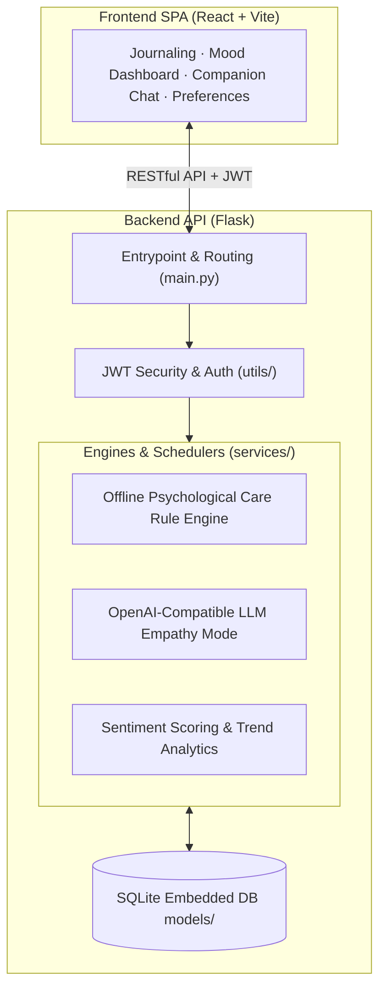

[简体中文](README.md) | English

# Heart Garden · 心语花园

**A local-first personal mood diary and hybrid emotional companion agent.**

`Heart Garden` is a privacy-first emotional logging and companion platform that seamlessly merges journaling, sentiment scoring, trend visualization, and interactive conversational support. Built on a hybrid architecture combining a local offline rule engine with optional external LLMs, it operates entirely offline without third-party dependencies while supporting OpenAI-compatible foundation models for empathetic multi-turn dialogue—automatically falling back to local heuristic rules if remote API calls fail.

---

## Key Features

* **Privacy-First & Local Storage**: All personal journals, emotional metrics, and companion logs are saved to an embedded SQLite database. API keys are masked and encrypted; private reflections never touch the cloud without explicit consent.
* **Hybrid Dual-Engine Architecture**:
  * **Offline Heuristic Engine**: Works out of the box using built-in psychological sentiment lexicons and rule-based conversational heuristics with zero API latency.
  * **LLM Empathetic Mode**: Integrates with any OpenAI-compatible endpoint (GPT, DeepSeek, Claude) for deep, multi-turn emotional resonance.
  * **Seamless Fallback**: If upstream model calls encounter timeouts or rate limits, the system transparently degrades to local rules, clearly labeling the response origin in the UI.
* **Sentiment Scoring & Visual Trends**: Automatically computes sentiment polarity and mood tags from diary entries, visualizing weekly/monthly emotional trajectories on interactive charts.
* **Proactive Wellness Reminders**: Monitors consecutive low-mood patterns to dispatch gentle supportive check-ins and weekly recaps, respecting configurable Do-Not-Disturb windows.
* **User Isolation & JWT Security**: Full user registration and JWT authentication ensuring strict multi-user data segregation on shared machines.

---



* **`app/`**: Flask backend service
  * `main.py`: Entrypoint and route handlers
  * `models/`: SQLite schemas (User, Diary, Sentiment, Settings)
  * `services/`: Hybrid chat router, sentiment analysis engine, notifications
  * `utils/`: JWT authentication and security filters
* **`frontend/`**: Responsive React + Vite application
* **`start.bat`**: Windows all-in-one background launcher

---

## Quick Start

### Requirements
* **Python**: 3.9 or newer
* **Node.js**: 18 or newer
* **Database**: SQLite 3.8+ (bundled with Python)

### Running the Project

#### 1. Windows One-Click Launch
Double-click `start.bat` in the project root to run both the backend API and frontend dev server simultaneously.

#### 2. Manual Startup
```bash
# Terminal 1: Backend service
python -m venv venv
# Windows:
venv\Scripts\Activate.ps1
# macOS/Linux:
# source venv/bin/activate

pip install -r requirements.txt
python -m app.main

# Terminal 2: Frontend client
cd frontend
npm install
npm run dev
```

The frontend will run at `http://localhost:3001` and the backend service at `http://localhost:5000`.

---

## LLM Configuration

1. The platform runs in offline rule mode by default with zero configuration required.
2. To enable LLM integration, navigate to **Settings** in the web app:
   * Toggle **Use LLM Chat** on;
   * Specify your OpenAI-compatible Base URL, Model name, and API Key;
   * Click **Test Connection**, then **Save Configuration**.
3. Stored credentials are automatically masked upon saving, and the frontend never retrieves plain-text secrets.

---

## License

This project is open-sourced under the [MIT License](LICENSE).
